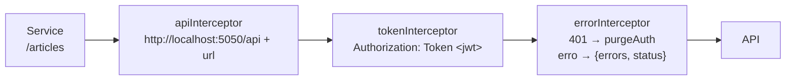

# ADR-011 — Integração front → API por cadeia de interceptors

- **Status:** aceita (retroativa). Registrada a partir do código `web` no commit `d51aa2d`.
- **Abrangência:** front inteiro e o contrato com a API.
- **Relacionadas:** [ADR-007](https://github.com/luasosi/sentinela-workspace/blob/master/docs/adr/ADR-007-autenticacao-jwt-propria.md), [ADR-008](https://github.com/luasosi/sentinela-workspace/blob/master/docs/adr/ADR-008-formato-unico-de-erro.md), [ADR-009](https://github.com/luasosi/sentinela-workspace/blob/master/docs/adr/ADR-009-contrato-http-realworld.md), [ADR-010](ADR-010-front-angular-standalone-por-feature.md). Detalhes em [mapa-integracoes.md §1](https://github.com/luasosi/sentinela-workspace/blob/master/docs/mapa-integracoes.md#1-chamadas-http-dos-services-e-montagem-da-url).

## Decisão

Os services usam URLs relativas (`/articles`, `/user`) e não montam cabeçalhos. Toda a parte transversal de HTTP fica em três interceptors funcionais, nesta ordem (`web/src/app/app.config.ts:73`):

| Interceptor        | O que faz                                                                                     | Evidência                                                  |
| ------------------ | --------------------------------------------------------------------------------------------- | ---------------------------------------------------------- |
| `apiInterceptor`   | Prefixa a URL com `http://localhost:5050/api`, uma base **fixa no código**, sem `environment` | `web/src/app/core/interceptors/api.interceptor.ts:3-6`     |
| `tokenInterceptor` | Adiciona `Authorization: Token <jwt>` quando há token                                         | `web/src/app/core/interceptors/token.interceptor.ts:5-14`  |
| `errorInterceptor` | Em 401 fora de `/user`, desloga; normaliza o erro para `{ errors, status }`                   | `web/src/app/core/interceptors/error.interceptor.ts:32-54` |

- O token fica em `localStorage['jwtToken']` (`web/src/app/core/auth/services/jwt.service.ts:5-15`).
- Na inicialização, se há token, a app chama `GET /user` para validá-lo. Sem token, vai para `unauthenticated` (`web/src/app/app.config.ts:56-67`, `:74-77`).
- A app expõe `window.__conduit_debug__` (token, `AuthState` e usuário) para os testes e2e (`web/src/app/app.config.ts:18-45`).

## Regras que decorrem

- Um service novo usa URL relativa sem `/api` e não define cabeçalho de autenticação.
- Ao mudar a porta em `api/subir-api.ps1`, atualize o `apiInterceptor` junto (`AGENTS.md` da raiz).

## Consequências

- A URL da API não muda por ambiente sem alterar o código. Rodar o front contra outro endereço exige editar o `apiInterceptor` **(inferido)**.
- Os specs Vitest dos services não registram os interceptors e esperam as URLs sem `/api` ([mapa-integracoes.md §4](https://github.com/luasosi/sentinela-workspace/blob/master/docs/mapa-integracoes.md#4-testes-existentes)).
